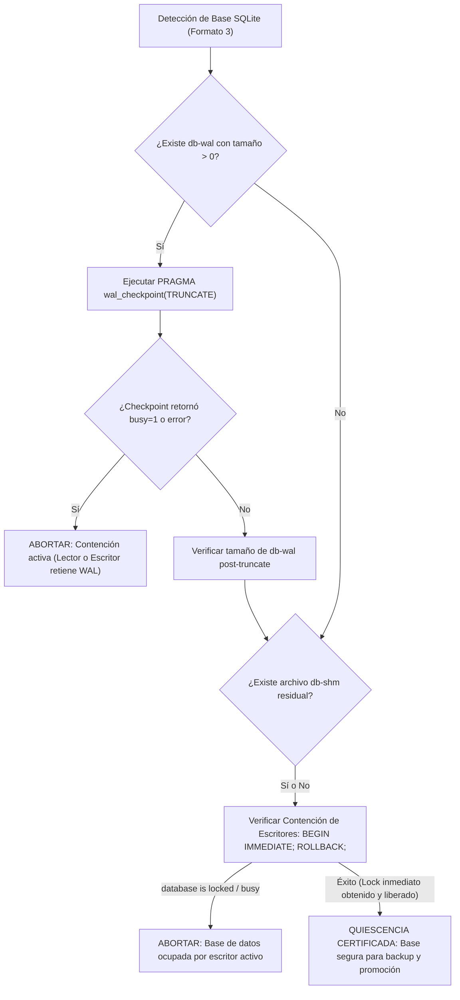

# RUNBOOK DE PROMOCIÓN OPERATIVA, QUIESCENCIA Y RECUPERACIÓN VERIFICADA (G14)

## OpenMemory Milestone G14 — Safe Promotion Readiness, SQLite Quiescence Policy & Operational Runbook

**Fecha:** 19 de octubre de 2026  
**Rama autorizada:** `fix/p0-security-concurrency-hardening`  
**Repositorio canónico:** `C:\Users\sant1\Downloads\OpenMemory`  
**Consumidor protegido:** `C:\Users\sant1\OneDrive\Documentos\ChatGPT\OpenMemory\InventoryHub`  
**Candidato calificado:** `openmemory@0.3.15-rc2.tgz` (190,051 bytes, SHA-256: `a82a2a02a5db20d0d96ae8fb913c04ca937e683da870d7fdbddb06ea77f8bfc5`)  
**Línea base histórica inmutable:** `openmemory@0.3.15-rc1.tgz` (184,295 bytes, SHA-256: `8b3df7e15222cfcce93d33044efc817e2c10564aa996af389a9603b66595d716`)  
**Estado de Gobernanza:** **AUTORIZACIÓN LOCAL RESTRINGIDA — PROHIBIDA LA PROMOCIÓN REAL DE INVENTORYHUB SIN ORDEN HUMANA EXPRESA**

---

## 1. Alcance y Principios Operativos

Este Runbook define el procedimiento técnico, determinista e irreversible para llevar a cabo la promoción operativa del candidato `openmemory@0.3.15-rc2` sobre el consumidor de referencia `InventoryHub`, transitando de forma segura desde la línea base activa `openmemory@0.3.14-rc4`.

### Principios Mandatorios de la Misión G14
1. **Inviolabilidad de la Producción:** Ninguna operación real de promoción, mutación de bases de datos o reemplazo de paquetes puede ejecutarse en `InventoryHub` durante fases de prueba o certificación.
2. **Semántica Rigurosa de Dry-Run (B1):** Una simulación de promoción debe ser inequívocamente distinguible de una promoción real:
   - Estado terminal de simulación: `DRY_RUN_PASSED`.
   - Cero mutaciones en el sistema de archivos del consumidor.
   - Cero paquetes instalados.
   - Cero directorios de backup ficticios en `backups/`.
   - Cero manifiestos de operación marcados como `COMMITTED`.
3. **Política Estricta de Quiescencia SQLite (B2):**
   - La presencia aislada de un archivo `-shm` (memoria compartida) no demuestra una transacción activa si ningún proceso retiene locks de lectura/escritura.
   - La presencia de un archivo `-wal` con tamaño mayor a cero requiere un checkpoint forzado y verificación transaccional; jamás se eliminan archivos `-wal` o `-shm` a mano.
   - Si existen lectores activos o un escritor con lock exclusivo, el motor aborta la promoción inmediatamente en fase de preflight (`PROMOTION_BLOCKED`).
4. **Idempotencia de Rollback y Recuperación (B3):** Cualquier falla en fase de aplicación o verificación dispara un rollback integral que restaura el 100 % de los archivos del consumidor y de las bases SQLite con paridad criptográfica exacta.

---

## 2. Taxonomía de Estados Operativos

Para garantizar que los operadores humanos y los agentes automatizados interpreten sin ambigüedad los resultados del motor transaccional, se definen cuatro estados terminales mutuamente excluyentes:

| Estado Terminal | Significado Operativo | Modificaciones en Consumidor | Backups Persistidos |
| :--- | :--- | :--- | :--- |
| **`DRY_RUN_PASSED`** | La simulación completó con éxito la auditoría criptográfica, la comprobación de quiescencia SQLite, la validación de dependencias y la verificación de locks. | **0 mutaciones** | **0 backups** (No engañosos) |
| **`PROMOTION_COMMITTED`** | La promoción física se completó exitosamente: backup transactional creado, tarball aplicado, smoke test superado, post-verificación de base de datos validada y lock liberado. | Promoción confirmada a 0.3.15-rc2 | Backup archivado en `backups/` con catálogo SHA-256 |
| **`PROMOTION_ROLLED_BACK`** | Ocurrió un fallo en instalación, smoke test o post-verificación; el rollback transaccional automático restauró el estado previo al 100 % con paridad criptográfica. | Restaurado a 0.3.14-rc4 | Backup y manifiesto preservados para auditoría forense |
| **`PROMOTION_BLOCKED`** | El preflight detectó contención activa en SQLite, colisión de locks concurrentes, corrupción en el tarball candidato o rutas inválidas antes de iniciar mutaciones. | **0 mutaciones** | **0 backups** |

---

## 3. Política Canónica de Quiescencia SQLite (B2)

SQLite en modo WAL (Write-Ahead Logging) utiliza dos archivos auxiliares contiguos a la base de datos principal (`db-wal` y `db-shm`). Para evitar corrupciones catastróficas o fallos de promoción bajo contención, el motor implementa el siguiente protocolo determinista:



### Reglas No Negociables de Operación:
1. **Prohibición de Borrado Manual:** Bajo ninguna circunstancia el operador o un script debe borrar manualmente archivos `-wal` o `-shm`. Si un proceso activo mantiene la base abierta, borrar el WAL desincroniza el encabezado del archivo principal y produce pérdida irrecuperable de datos.
2. **Archivos SHM Residuales:** Un archivo `-shm` residual (de 32 KB) remanente tras el cierre limpio del último proceso es inocuo y no constituye por sí mismo motivo de bloqueo, siempre que la prueba de contención inmediata (`BEGIN IMMEDIATE`) pase limpiamente y no haya WAL pendiente.
3. **Manejo de Contención:** Si la prueba de contención falla, el motor genera un error de preflight:
   `PREFLIGHT_ERROR: Active SQLite contention detected in <dbPath>: database is locked` y detiene la promoción en `PROMOTION_BLOCKED`.

---

## 4. Precondiciones de Ejecución

Antes de iniciar la ejecución en cualquier entorno, verificar la lista de verificación:

- [ ] **Autorización Expresa:** Confirmación humana registrada para el mantenimiento.
- [ ] **Working Tree Limpio:** Repositorio en rama `fix/p0-security-concurrency-hardening` sin modificaciones espurias.
- [ ] **Identidad Criptográfica del Artefacto:**
  - Archivo: `.work/artifacts/openmemory-0.3.15-rc2.tgz`
  - Tamaño: 190,051 bytes
  - SHA-256: `a82a2a02a5db20d0d96ae8fb913c04ca937e683da870d7fdbddb06ea77f8bfc5`
  - SHA-512 (base64): `xDAzTSQgn4DT2c1bVOud9dqKda3+TS3HzoT2Ld7PSy0KIDH9mM/uI/JkgdljDGAfn9vp9zzD40lmvFoiQ9WqUg==`
- [ ] **Ausencia de Locks Activos:** No debe existir `.promotion.lock` en el consumidor.
- [ ] **Aserciones Contables de InventoryHub:** Ejecutar y validar que las 34/34 aserciones contables de `InventoryHub` pasen al 100 %.

---

## 5. Procedimiento de Ejecución Paso a Paso

### Paso 0: Verificación Criptográfica de la Cadena de Suministro
Ejecutar el verificador independiente fail-closed contra el manifiesto G14:

```bash
cd C:\Users\sant1\Downloads\OpenMemory
node scripts/verify-release-artifact.js \
  --tarball .work/artifacts/openmemory-0.3.15-rc2.tgz \
  --manifest docs/G14_EVIDENCE_MANIFEST.json
```
*Resultado esperado:* `SUPPLY CHAIN ARTIFACT INTEGRITY VERIFIED (EXIT 0)`.

---

### Paso 1: Ejecución de Simulación Segura (Dry-Run Obligatorio)
Antes de cualquier promoción física, es obligatorio ejecutar la simulación para auditar preflight, quiescencia SQLite e integridad sin mutar disco:

```bash
node scripts/transactional-promotion-engine.js \
  --consumer C:\Users\sant1\OneDrive\Documentos\ChatGPT\OpenMemory\InventoryHub \
  --tarball .work/artifacts/openmemory-0.3.15-rc2.tgz \
  --expected-sha256 a82a2a02a5db20d0d96ae8fb913c04ca937e683da870d7fdbddb06ea77f8bfc5 \
  --expected-size 190051 \
  --expected-version 0.3.15-rc2 \
  --dry-run
```
*Resultado esperado:*
```json
{
  "success": true,
  "state": "DRY_RUN_PASSED",
  "outcome": "DRY_RUN_PASSED",
  "isDryRun": true
}
```
*Comprobación posterior al dry-run:*
1. `git status` en InventoryHub debe mostrar 0 cambios.
2. No debe crearse ningún directorio en `InventoryHub/backups/`.
3. No debe crearse ningún archivo `InventoryHub/operation_manifest.json`.

---

### Paso 2: Ejecución de la Promoción Real (Exclusivamente tras Autorización Humana)
Una vez validado el dry-run y contando con la orden explícita de liberación:

```bash
node scripts/transactional-promotion-engine.js \
  --consumer C:\Users\sant1\OneDrive\Documentos\ChatGPT\OpenMemory\InventoryHub \
  --tarball .work/artifacts/openmemory-0.3.15-rc2.tgz \
  --expected-sha256 a82a2a02a5db20d0d96ae8fb913c04ca937e683da870d7fdbddb06ea77f8bfc5 \
  --expected-size 190051 \
  --expected-version 0.3.15-rc2
```
*Flujo transaccional ejecutado internamente:*
1. **Adquisición de Lock:** Crea `.promotion.lock` con PID activo y timestamp.
2. **Preflight y Quiescencia:** Verifica hash, tamaño, versión previa (`0.3.14-rc4`) y certifica quiescencia de todas las bases SQLite (`test-inventory-data.db`).
3. **Backup Transaccional Atómico:** Respalda `.openmemory/`, `package.json`, el tarball previo y genera el catálogo de hashes SHA-256 en `backups/backup_promo_<timestamp>/`.
4. **Instalación:** Ejecuta `npm install .work/artifacts/openmemory-0.3.15-rc2.tgz --save-exact`.
5. **Smoke Test:** Ejecuta validación in-situ de importaciones públicas y registro de herramientas MCP (mínimo 29 herramientas activas).
6. **Post-Verificación:** Comprueba que los hashes de las bases SQLite se mantuvieron estrictamente inmutables durante la actualización.
7. **Commit:** Registra estado `COMMITTED` en `operation_manifest.json` y libera el lock.
*Resultado esperado:* `outcome: "PROMOTION_COMMITTED"`.

---

### Paso 3: Verificación de Aceptación Post-Promoción
Validar inmediatamente el correcto funcionamiento de InventoryHub bajo la nueva versión:

```bash
cd C:\Users\sant1\OneDrive\Documentos\ChatGPT\OpenMemory\InventoryHub
node test_inventory_manager.js
node test_phase_2c2_full.js
node test_phase_2c4_post_cleanup.mjs
```
*Resultado esperado:* 34/34 aserciones pasando al 100 %.

---

### Paso 4: Monitoreo y Observabilidad MCP
Auditar el estado operativo y de integridad mediante las herramientas MCP de OpenMemory:

```json
// Llamada a herramienta MCP: openmemory_promotion_status
{
  "consumerPath": "C:\\Users\\sant1\\OneDrive\\Documentos\\ChatGPT\\OpenMemory\\InventoryHub"
}
```
*Respuesta esperada:*
```json
{
  "isInterrupted": false,
  "lastOperationId": "promo_...",
  "state": "COMMITTED",
  "isDryRun": false,
  "outcome": "PROMOTION_COMMITTED",
  "hasActiveLock": false,
  "backupCount": 1
}
```

---

## 6. Procedimiento de Emergencia y Recuperación (Rollback)

Si durante la promoción física ocurriera un corte de energía, terminación forzada del proceso (`SIGKILL`) o fallo imprevisto:

### 1. Detección Automática de Operación Interrumpida:
Al reiniciar, el motor o la herramienta MCP detectarán el estado inconsistente:
```bash
node -e "
const { TransactionalPromotionEngine } = require('./scripts/transactional-promotion-engine');
const status = TransactionalPromotionEngine.checkForInterruptedPromotion('C:\\Users\\sant1\\OneDrive\\Documentos\\ChatGPT\\OpenMemory\\InventoryHub');
console.log(status);
"
```

### 2. Disparo de Recuperación Idempotente:
Ejecutar la recuperación manual garantizada:
```bash
node -e "
const { TransactionalPromotionEngine } = require('./scripts/transactional-promotion-engine');
const res = TransactionalPromotionEngine.recoverInterruptedPromotion('C:\\Users\\sant1\\OneDrive\\Documentos\\ChatGPT\\OpenMemory\\InventoryHub');
console.log(res);
"
```
*Garantías del procedimiento de recuperación:*
- Desaloja el lock huérfano de PID extinto sin bloquearse.
- Si el manifiesto de operación está truncado o corrupto, lo pone en cuarentena forense y busca el backup atómico más reciente válido.
- Restaura `.openmemory/` y reinstala la versión previa `0.3.14-rc4`.
- Comprueba que la recuperación sea estrictamente idempotente si se ejecuta múltiples veces seguidas.

---

## 7. Criterios de Aceptación y Veredicto Final

La promoción sólo se considera formalmente aprobada cuando:
1. El dry-run arrojó `DRY_RUN_PASSED` sin ninguna mutación colateral.
2. La quiescencia SQLite se certificó sin lectores ni escritores retenidos.
3. La promoción concluyó en `PROMOTION_COMMITTED`.
4. El paquete activo en InventoryHub es `openmemory@0.3.15-rc2`.
5. Las 34/34 pruebas contables pasaron exitosamente.
6. El status MCP confirma `isInterrupted: false` y `state: "COMMITTED"`.
