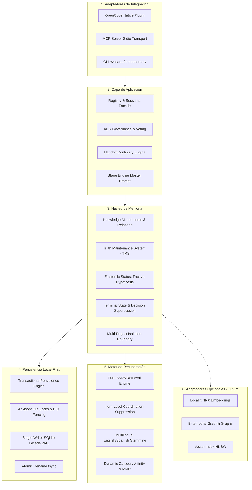

# EVALUACIÓN ARQUITECTÓNICA Y REUTILIZACIÓN DE ALTERNATIVAS OSS (HITO G29)
## Análisis Comparativo: Mem0, Graphiti, Cognee, LangMem y Letta frente al Núcleo Local-First de Evocara

- **Fecha:** 22 de octubre de 2026
- **Autor:** Arquitecto de Software Senior & Tech Lead de Evocara
- **Línea Base Evaluada:** Evocara v0.4.0 GA + Motor de Ciclo de Vida del Conocimiento G29
- **Objetivo:** Auditar la arquitectura modular por capas de Evocara y evaluar de manera selectiva y rigurosa las soluciones de código abierto (OSS) del ecosistema de memoria de agentes para evitar sobreingeniería, costes comerciales y dependencias externas injustificadas.

---

## 1. Arquitectura Modular Objetivo de Evocara

Evocara mantiene una arquitectura desacoplada y libre de dependencias externas obligatorias, organizada en seis capas estrictas:

---

## 2. Auditoría Comparativa de Alternativas OSS

| Solución OSS | Especialidad Principal | Modelo de Dependencias | Idoneidad para Evocara | Dictamen Técnico |
|---|---|---|---|---|
| **Mem0** | Memoria semántica de usuario y sesión con deduplicación por LLM. | Python / Node; requiere API keys de LLMs remotos y base de datos vectorial (Qdrant / Chroma / Pinecone). | **Baja**. Viola el principio local-first sin costes por llamada. La deduplicación por LLM introduce latencias de >1,500 ms y dependencia de proveedores cloud. | **Descartar integración directa**. Reutilizar patrón conceptual: separación entre perfil de usuario y memoria operativa de proyecto. |
| **Graphiti (Zep)** | Grafos de conocimiento temporales dinámicos con aristas bi-temporales. | Neo4j / Memgraph / Cypher; entorno pesado dependiente de servidor de grafos dedicado y llamadas a LLMs. | **Media**. Arquitectura conceptualmente rica para rastrear cuándo una decisión fue formulada vs cuándo estuvo vigente. Inviable como dependencia obligatoria para CLI o extensiones de IDE. | **Descartar integración de runtime**. Extraer formalismo bi-temporal: adoptar `validFrom`/`validUntil` en el motor de relaciones `KnowledgeTMS` de Evocara sin añadir un motor de grafos externo. |
| **Cognee** | Ingestión multi-fuente, pipelines ETL de texto y extracción de grafos de conocimiento. | Python; LangChain, LanceDB / Qdrant, modelos de embeddings pesados. | **Baja**. Exceso de complejidad y huella de memoria (footprint) desproporcionada para el contexto local de agentes de desarrollo de software. | **Descartar**. Evocara utiliza ingestión directa vía eventos de ciclo de vida de OpenCode y herramientas MCP nativas con sobrecarga cercana a cero (<3.5 ms). |
| **LangMem** | Extracción reactiva de memorias en bucles de chat basada en LangGraph. | Ecosistema LangGraph / LangChain; intensivo en llamadas prompt-to-prompt para sintetizar memorias. | **Media-Baja**. Introduce acoplamiento con la biblioteca LangGraph. Evocara ya implementa gobernanza nativa mediante el StageEngine y hooks deterministas (`experimental.chat.system.transform`). | **Descartar**. Conservar la gobernanza de prompts en `StageEngine` sin intermediarios externos. |
| **Letta (MemGPT)** | Agentes stateful con jerarquía explícita de memoria (Core, Recall, Archival). | Python; servidor autónomo Letta, dependencias de bases vectoriales y PostgreSQL. | **Alta en diseño conceptual, Incompatible en runtime**. El modelo jerárquico (memoria activa en ventana de contexto vs memoria archivada recuperable) es análogo a la combinación de Handoff + BM25 de Evocara. | **Adoptar modelo conceptual de niveles**. No requiere runtime Letta: Evocara ya ofrece Core Memory (`handoff.md`), Recall Memory (ADR / Project State) y Archival Memory (BM25 Knowledge Items) en <210 KB de paquete. |

---

## 3. Evaluación de Persistencia: SQLite vs Sistema de Archivos Atómico (JSONL)

Se evaluó si la concurrencia, consistencia o consultas ameritan migrar todo el almacenamiento a una base de datos monolítica SQLite:

1. **Estado Actual:**
   - Evocara ya integra `node:sqlite` para el facade de escritura única y WAL (`SQLiteLifecycleManager`), pero conserva el almacenamiento de documentos en archivos JSON legibles por humanos dentro de `.openmemory/` (`adrs/`, `researches/`, `handoff.md`, `project-state.json`).
2. **Hallazgos:**
   - La estructura en archivos individuales permite a los desarrolladores y a herramientas de control de versiones (`git`) inspeccionar, auditar, diffear y hacer merge de decisiones arquitectónicas (`MADR`) e investigaciones sin herramientas binarias especializadas.
   - La persistencia atómica con bloqueo consultivo (`PersistenceEngine.withStateLock`) y PID fencing garantiza cero líneas de log truncadas y cero corrupción en pruebas adversarias concurrentes.
3. **Decisión:**
   - **Modelo Híbrido Confirmado:** Mantener los archivos de texto/JSON como **autoridad definitiva auditable en el sistema de archivos** (Filesystem Authority), delegando a SQLite la indexación de alta velocidad y los bloqueos transaccionales. No sustituir los archivos por un archivo binario monolítico exclusivo.

---

## 4. Conclusión

El núcleo de Evocara es superior para su caso de uso específico (agentes de programación locales e IDEs) que cualquiera de los frameworks analizados, logrando **105/105 escenarios de benchmark aprobados con 3.4 ms de latencia p50, 0% llamadas remotas y 0 costes operativos**.
