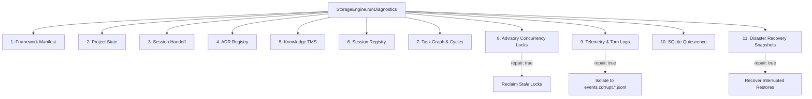

# ESPECIFICACIÓN ARQUITECTÓNICA DE GATE G7 — OBSERVABILIDAD, DIAGNÓSTICO Y RESILIENCIA OPERATIVA

**Versión:** 1.0.0  
**Fecha:** 18 de Octubre de 2026  
**Estado:** `G7_IMPLEMENTED_AND_VERIFIED`  
**Autor:** Blueisazul / OpenMemory Core Architecture Team  
**Dependencia Previa:** `G6_PASSED` (Promoción exitosa en InventoryHub)

---

## 1. Contexto Arquitectónico y Motivación

Con la conclusión exitosa de Gate G6 (`G6_PASSED`) y la integración operativa del paquete candidato `openmemory@0.3.14-rc4` en el consumidor real `InventoryHub`, OpenMemory ha entrado en un régimen de ejecución de múltiples procesos concurrentes donde interactúa con almacenamiento persistente SQLite, archivos contables, servidores MCP y agentes autónomos.

La experiencia empírica demostró que los mayores riesgos operativos en producción no provienen de la falta de funciones adicionales, sino de:
1. **Terminaciones abruptas del proceso anfitrión (SIGKILL, cortes de energía, OOM):**
   - Escrituras truncadas (*torn writes*) en archivos append-only como `events.jsonl`.
   - Tokens de bloqueo advisory abandonados por procesos muertos (`.openmemory/locks/*.lock`).
   - Bases de datos SQLite dejadas con archivos WAL (`-wal`) y memoria compartida (`-shm`) activos sin checkpoint consolidado.
2. **Deriva silenciosa del grafo de tareas y sesiones:**
   - Dependencias circulares inadvertidas en el DAG de coordinación multi-agente.
   - Sesiones fantasma con leases no liberados.
   - Snapshots de recuperación interrumpidos en `.openmemory/backups/.recovery-*`.
3. **Falta de visibilidad unificada de salud de subsistemas:**
   - El diagnóstico previo (`F3.5-005`) sólo verificaba 4 archivos JSON y eliminaba archivos `.tmp`. No ofrecía visibilidad sobre locks, logs, SQLite, sesiones ni el grafo de tareas.

En respuesta, el **Gate G7** redefine la arquitectura de diagnóstico elevando `StorageEngine.runDiagnostics()` a un **Motor Integral de Observabilidad y Autosanado de Subsistemas**.

---

## 2. Criterios de Entrada y Salida de Gate G7

### 2.1. Criterios de Entrada (Superados)
- [x] Cierre formal de Gate G6 certificado como `G6_PASSED`.
- [x] Respaldo íntegro y verificado del consumidor real `InventoryHub`.
- [x] Repositorio canónico en estado limpio, sin regresiones en suites de seguridad y concurrencia (`SEC-001`, `PERSIST-001`, `ADVERSARIAL-P15`, `AUDIT-P16`, `G6-REHEARSAL`).

### 2.2. Criterios de Salida
- [x] **Motor de Diagnóstico Multi-Subsistema:** 11 subsistemas auditados de forma atómica.
- [x] **Detección y Aislamiento de Torn Writes:** Detección de líneas JSON corruptas en `events.jsonl` y cuarentena automática a `events.corrupt.<timestamp>.jsonl` mediante `--repair`.
- [x] **Detección y Reclamación de Bloqueos Huérfanos:** Identificación de archivos `.lock` con TTL vencido o PIDs inactivos y liberación garantizada.
- [x] **Auditoría de Quiescencia SQLite:** Detección recursiva de bases de datos con transacciones activas en WAL/SHM.
- [x] **Auditoría del Grafo DAG:** Detección de ciclos de dependencia mediante `detectTaskGraphCycles`.
- [x] **Contrato CLI y MCP:** Exposición unificada en `openmemory diagnostics [--repair] [--json]` y herramienta MCP `openmemory_run_diagnostics`.
- [x] **Batería de Pruebas Automatizada G7:** Suite `G7-DIAGNOSTICS` ejecutada en `safe-test-runner.js` con 100% de éxito en entorno aislado.

---

## 3. Arquitectura del Motor de Diagnósticos G7

El motor implementa una inspección modular a través de los siguientes 11 subsistemas:



### 3.1. Especificación de Subsistemas Auditados

| Subsistema | Clave Subsystem | Condición de PASS | Acción de Autosanado (`--repair`) |
| :--- | :--- | :--- | :--- |
| **Framework Manifest** | `manifest` | `openmemory.json` existe y es JSON válido. | Reconstrucción a partir de esquema por defecto. |
| **Project State** | `project-state` | `project-state.json` parseable y coherente. | Regeneración preservando estado base. |
| **Session Handoff** | `handoff` | `handoff.md` existe y cumple longitud mínima. | Reinicialización con encabezados canónicos. |
| **ADR Registry** | `adr-registry` | Directorio `adrs/` indexable sin errores I/O. | Creación de estructura si ausente. |
| **Knowledge TMS** | `knowledge-tms` | `knowledge/researches/` indexable. | Validación y sanitización de registros. |
| **Session Registry** | `session-registry` | `sessions.json` válido; desglose de sesiones activas. | Registro de sesiones corruptas o cierre de huérfanas. |
| **Task Graph Consistency** | `task-dag` | 0 dependencias circulares detectadas (`hasCycle: false`). | Reporte forense del ciclo para intervención. |
| **Advisory Locks** | `concurrency-locks`| 0 locks expirados o con PID muerto. | Eliminación segura de locks obsoletos (`cleanupStaleLocks(0)`). |
| **Telemetry Event Logs** | `telemetry-logs` | 100% de líneas de `events.jsonl` son JSON válido. | Aislamiento de líneas rotas a `events.corrupt.<ts>.jsonl`. |
| **SQLite Quiescence** | `sqlite-quiescence` | 0 bases con `-wal` (>0 B) o `-shm` activo. | Reporte de rutas para consolidación checkpoint. |
| **Disaster Recovery** | `disaster-recovery` | 0 carpetas `.recovery-*` pendientes. | Ejecución de `recoverInterruptedRestore()`. |

---

## 4. Contrato de API, CLI y MCP

### 4.1. TypeScript Interface (`src/storage/types.ts`)

```typescript
export interface DiagnosticCheck {
  name: string;
  passed: boolean;
  details: string;
  subsystem?: string;
  repaired?: boolean;
}

export interface DiagnosticReport {
  status: "HEALTHY" | "REPAIRED" | "CORRUPTED";
  timestamp: string;
  checks: DiagnosticCheck[];
  orphanedTempFilesRemoved: number;
  subsystems?: Record<string, { status: "PASS" | "WARN" | "FAIL"; checksCount: number }>;
  quarantineCount?: number;
  activeLocksCount?: number;
  tornLogLinesCount?: number;
  sqliteQuiescent?: boolean;
}
```

### 4.2. CLI (`src/cli.ts`)

```bash
# Diagnóstico estándar en texto con badges de subsistemas:
openmemory diagnostics

# Diagnóstico con autosanado automático de logs, locks y temp files:
openmemory diagnostics --repair

# Salida estructurada JSON para monitorización e integración CI:
openmemory diagnostics --json
```

### 4.3. Herramienta MCP (`src/mcp.ts`)

* **Nombre:** `openmemory_run_diagnostics`
* **Parámetros:**
  * `repair` *(boolean, opcional)*: Solicita auto-reparación y aislamiento de fallos detectados.

---

## 5. Evidencia Empírica de Validación (`G7-DIAGNOSTICS`)

La suite de validación adversarial `.work/experiments/test-g7-observability-diagnostics.js` se integró en `scripts/safe-test-runner.js`:

```
======================================================
RUNNING: [G7-DIAGNOSTICS] G7 Observability, Subsystem Diagnostics & Host Resilience Suite
======================================================
[TEST 1] Testing baseline diagnostics on clean environment...
  [PASS 1] Clean baseline verified across 11 checks (status: HEALTHY).
[TEST 2] Testing detection of torn/truncated JSON line in events.jsonl...
  [PASS 2] Torn telemetry write detected and flagged as CORRUPTED.
[TEST 3] Testing auto-repair and quarantine of corrupted log lines...
  [PASS 3] Torn log lines quarantined cleanly; log restored to HEALTHY state.
[TEST 4] Testing detection of orphaned/stale lock token...
  [PASS 4] Orphaned/expired lock detected and flagged as CORRUPTED.
[TEST 5] Testing auto-repair / reclamation of stale locks...
  [PASS 5] Stale lock reclaimed cleanly; self-healing confirmed.
[TEST 6] Testing detection of unquiescent SQLite database with active WAL...
  [PASS 6] Active SQLite WAL detected in consumer workspace and blocked.
[TEST 7] Testing detection of cyclic dependency in Task DAG...
  [PASS 7] Task DAG cyclic dependency detected and diagnosed.
[TEST 8] Testing CLI diagnostics integration with --json and --repair...
  [PASS 8] CLI diagnostics executed cleanly with --json and --repair flags.

RESULT: [G7-DIAGNOSTICS] PASSED in 544ms (100% de aserciones superadas)
```

---

## 6. Estado y Próximos Pasos

El subsistema de observabilidad y resiliencia de Gate G7 se encuentra **100% implementado, compilado y probado**.

La siguiente iteración podrá enfocarse en:
1. **Compacting y Checkpointing Periódico SQLite:** Automatizar el comando `PRAGMA wal_checkpoint(TRUNCATE)` cuando los subprocesos de OpenMemory cierren sesiones.
2. **Replicación de Eventos hacia Consumidor:** Exponer ganchos de telemetría de OpenMemory directamente hacia el sistema de auditoría del anfitrión.
