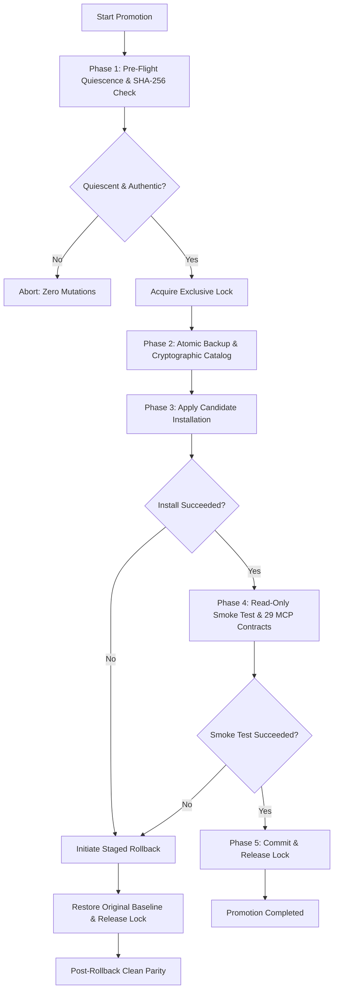

# P1.7 INVENTORYHUB PROMOTION READINESS & OPERATIONAL RUNBOOK

**Document ID:** `OM-P1.7-DOC-005`  
**Iteration:** P1.7 — Autonomous Verification, Remote CI Reconciliation & Release Readiness  
**Target Protected Consumer:** `C:\Users\sant1\OneDrive\Documentos\ChatGPT\OpenMemory\InventoryHub`  
**Candidate Package:** `openmemory@0.3.14-rc4` (`.work/artifacts/openmemory-0.3.14-rc4.tgz`)  
**Status:** PROMOTION READINESS VALIDATED — PENDING OPERATIONAL AUTHORIZATION  

---

## 1. Safety Mandate & Zero-Mutation Statement

In strict compliance with Misión P1.7 Section 2 rules:
* **Zero mutations** were performed on `InventoryHub`.
* No packages were installed, updated, or removed in the consumer.
* No SQLite databases, WAL/SHM files, ADRs, lockfiles, or state files in `InventoryHub` were modified.
* All promotion engine behaviors and fault scenarios were validated exclusively in isolated, synthetic sandbox environments.

This document prepares the exact operational procedure for Gate G6 (InventoryHub Promotion) so that it can be executed safely, idempotently, and reversibly once human operational authorization is granted.

---

## 2. Protected Consumer Baseline Inventory

Direct, non-invasive read-only inspection of `InventoryHub` established the following baseline:

* **Consumer Path:** `C:\Users\sant1\OneDrive\Documentos\ChatGPT\OpenMemory\InventoryHub`
* **Active Dependency:** `"openmemory": "file:scratch/exp2_10/fase4_5/dist/openmemory-0.3.1.tgz"`
* **Consumer Baseline Tarball:**
  * Path: `scratch/exp2_10/fase4_5/dist/openmemory-0.3.1.tgz`
  * Size: 147,676 bytes
  * SHA-256: `48d022f8ef35914769ef2df423a39a1c391cb383686e6a2575ca6906a115b1ef`
* **Operational Memory State:**
  * Directory: `.openmemory/`
  * State Files: `openmemory.json`, `project-state.json`, `handoff.md`
  * Subdirectories: `adrs/`, `backups/`, `knowledge/`, `locks/`, `logs/`, `reports/`
  * Lock State: 0 active lock files (quiescent).
  * SQLite WAL/SHM: 0 temporary journal files detected.

---

## 3. Transactional Promotion Architecture & Invariants

Promotion is orchestrated by `scripts/transactional-promotion-engine.js` following a 5-phase transactional lifecycle with bidirectional rollback guarantees:



### 3.1 Mutual Exclusion Lock Policy
* **Lock File:** `.openmemory/locks/promotion.lock`
* **Lock Payload:** Contains process PID, promotion UUID, candidate version, and ISO timestamp.
* **Stale Lock Timeout:** Locks older than 600,000ms (10 minutes) whose PID is no longer active in the OS process table are flagged as stale and can be reclaimed safely.

### 3.2 Pre-Flight Quiescence Check
* The promotion engine validates that no other process holds writer locks in `.openmemory/locks/`.
* It verifies all SQLite databases in the consumer workspace to confirm zero uncheckpointed transactions (ensuring no `-wal` or `-shm` files are locked by active SQLite connections).

### 3.3 Transactional Backup & Cataloging
* Prior to applying any package modification, the engine creates a full, timestamped snapshot of `.openmemory/` and the consumer's `package.json` into `.openmemory/backups/backup_<promo_id>/`.
* Every file is cataloged with its relative path, byte size, and SHA-256 checksum in `manifest.json`.

### 3.4 Staged Atomic Rollback Guarantee
* If npm installation fails, or if post-install verification fails, the engine triggers an automatic rollback.
* Rollback does not directly overwrite the destination directory. It recreates the verified directory in a separate temporary staging area, verifies checksum parity against `manifest.json`, and swaps the directory atomically.
* The original package (`openmemory-0.3.1.tgz`) is re-installed and verified.
* If a double-fault occurs during rollback, the engine quarantines the staging directory into `.openmemory/quarantine/` and preserves complete forensic logs in `promotion_abort_evidence.json`.

---

## 4. Synthetic Rehearsal Validation Evidence

The promotion engine was rigorously qualified using `scripts/rehearse-synthetic-promotion.js` across 8 operational stages on a simulated consumer matching InventoryHub's exact structure:

1. **Stage 1 (Artifact Verification):** Candidate tarball hash matched `af88fae90107dfda797c7f6bcc982cf6bbd7ef53fd9a5d887c9bf77185a35f6e`.
2. **Stage 2 (Sandbox Setup):** Synthetic consumer initialized with `openmemory@0.3.1` and SQLite memory store.
3. **Stage 3 (Dry-Run Mode):** Verified dry-run mode performs zero disk mutations and releases locks.
4. **Stage 4 (Live Promotion):** Successfully upgraded consumer to `openmemory@0.3.14-rc4`.
5. **Stage 5 (MCP Validation):** All 29 MCP tools verified against input schemas in consumer runtime.
6. **Stage 6 (Fault Injections):**
   * *Subtest 6a:* Failure during backup phase aborted cleanly with 0 mutations.
   * *Subtest 6b:* Failure during npm install triggered immediate rollback to `openmemory@0.3.1`.
   * *Subtest 6c:* Failure during smoke test triggered staged rollback with 100% bidirectional parity.
7. **Stage 7 (Double-Fault Handling):** Staging swap failure quarantined artifacts and persisted forensic evidence.
8. **Stage 8 (Idempotency):** Redundant rollback calls were cleanly ignored without state corruption.

---

## 5. Operational Pre-Flight Checklist for InventoryHub

Before executing promotion on `InventoryHub`, the operator must verify:

- [ ] **Maintenance Window:** Dedicated 30-minute window scheduled during low-activity period.
- [ ] **Host Quiescence:** No active OpenCode, IDE, or terminal sessions running against InventoryHub.
- [ ] **Lock Check:** Confirm `C:\Users\sant1\OneDrive\Documentos\ChatGPT\OpenMemory\InventoryHub\.openmemory\locks` has 0 files.
- [ ] **SQLite Quiescence:** Confirm no `.sqlite-wal` or `.db-wal` files exist in InventoryHub.
- [ ] **Git Working Tree:** InventoryHub Git working tree is clean (`git status` clean).
- [ ] **Candidate Tarball:** Verified tarball exists at `C:\Users\sant1\Downloads\OpenMemory\.work\artifacts\openmemory-0.3.14-rc4.tgz`.
- [ ] **Candidate SHA-256:** Verified hash is `af88fae90107dfda797c7f6bcc982cf6bbd7ef53fd9a5d887c9bf77185a35f6e`.
- [ ] **Human Authorization:** Explicit operational authorization received from repository owner.

---

## 6. Execution Command (Prepared for Authorized Operation)

When operational authorization is granted, execute the promotion engine with dry-run first, followed by live promotion:

### Step 1: Dry-Run Verification (Read-Only)
```powershell
node C:\Users\sant1\Downloads\OpenMemory\scripts\transactional-promotion-engine.js `
  --consumer "C:\Users\sant1\OneDrive\Documentos\ChatGPT\OpenMemory\InventoryHub" `
  --tarball "C:\Users\sant1\Downloads\OpenMemory\.work\artifacts\openmemory-0.3.14-rc4.tgz" `
  --verify-sha256 "af88fae90107dfda797c7f6bcc982cf6bbd7ef53fd9a5d887c9bf77185a35f6e" `
  --dry-run
```
*Expected Outcome:* Exit code 0, 0 files modified, report confirms all pre-flight conditions satisfied.

### Step 2: Live Controlled Promotion
```powershell
node C:\Users\sant1\Downloads\OpenMemory\scripts\transactional-promotion-engine.js `
  --consumer "C:\Users\sant1\OneDrive\Documentos\ChatGPT\OpenMemory\InventoryHub" `
  --tarball "C:\Users\sant1\Downloads\OpenMemory\.work\artifacts\openmemory-0.3.14-rc4.tgz" `
  --verify-sha256 "af88fae90107dfda797c7f6bcc982cf6bbd7ef53fd9a5d887c9bf77185a35f6e"
```
*Expected Outcome:* Exit code 0, atomic backup generated, `openmemory@0.3.14-rc4` installed, 29 MCP tools verified, promotion committed.

### Step 3: Emergency Rollback (If needed manually)
```powershell
node C:\Users\sant1\Downloads\OpenMemory\scripts\transactional-promotion-engine.js `
  --consumer "C:\Users\sant1\OneDrive\Documentos\ChatGPT\OpenMemory\InventoryHub" `
  --rollback `
  --backup-id "<backup_promo_id>"
```

---

## 7. Post-Promotion Verification & Acceptance Criteria

Promotion of InventoryHub will be deemed successful when:
1. `npm list openmemory` inside InventoryHub reports `openmemory@0.3.14-rc4`.
2. Existing InventoryHub ADRs, task records, and memory knowledge remain intact and accessible.
3. All 29 MCP tool schemas load without errors.
4. Transactional backup manifest is archived in `.openmemory/backups/`.
5. Mutual exclusion lock is cleanly deleted.