# DISEÑO DE RESTAURACIÓN TRANSACCIONAL Y RECUPERACIÓN POST-CRASH (F3.5 / P0.5 CONSOLIDADO)

**Módulo:** `src/storage/domains/backup-manager.ts`  
**Consumidor de API:** `src/storage.ts` (`StorageEngine.restoreBackup`, `StorageEngine.recoverInterruptedRestore`, `StorageEngine.createBackup`)  
**Estado:** `VERIFICADO Y AUDITADO ADVERSARIALMENTE` (Suite `TRANS-BACKUP` 56/56 superada)  
**Fecha:** 17 de octubre de 2026  
**Rama:** `fix/p0-security-concurrency-hardening`  
**Candidato Calificado:** `openmemory@0.3.14-rc4` (SHA-256: `af88fae90107dfda797c7f6bcc982cf6bbd7ef53fd9a5d887c9bf77185a35f6e`)

---

## 1. Contexto Arquitectónico y Modelo de Amenazas

En sistemas de memoria persistente para agentes autónomos (Local-First), la restauración de un snapshot no puede tratarse como una copia ingenua de archivos. Durante las auditorías de P0.3, P0.4 y la auditoría independiente de P0.5 se identificaron y mitigaron los siguientes vectores de falla y corrupción:

1. **Snapshots Incompletos / Manipulados:** Si un backup declara archivos en `manifest.json` pero alguno fue borrado de disco o carece de `manifest.json`, la restauración parcial o sin verificación criptográfica dejaría el sistema en un estado heterogéneo roto. En P0.5 se exige de forma mandatoria la existencia de `manifest.json` y la concordancia del 100% de los hashes SHA-256 antes de tocar el estado vivo.
2. **Caída Abrupta del Runtime durante la Aplicación:** Si el proceso sufre `SIGKILL`, corte de energía o fallo fatal mientras escribe sobre `.openmemory/`, los archivos quedan a medio escribir.
3. **Pérdida Catastrófica de Evidencia por Manifiesto Corrupto o Fase Ambigua:** Si el archivo de estado de la recuperación (`restore-recovery.json`) se corrompe por el crash o presenta una fase no reconocida, un limpiador ingenuo borraría el directorio `.recovery-<opId>`, destruyendo los únicos archivos capaces de revertir el estado vivo. En P0.5, toda fase ambigua se pone en **cuarentena no destructiva** (`.quarantined-recovery-*`).
4. **Fallo de E/S Durante el Propio Rollback (`FAILED_ROLLBACK`):** Si el disco se satura durante la reversión, el sistema registra el fallo (`FAILED_ROLLBACK`). En P0.5, el arranque posterior **reintenta el rollback** en lugar de eliminar la carpeta de recuperación, evitando la pérdida irreversible de los datos originales.
5. **Segunda Interrupción durante `RECOVERING`:** Si el proceso cae por segunda vez mientras está ejecutando el rollback compensatorio, el estado persiste como `RECOVERING` y el snapshot intacto permite que el siguiente arranque reanude la compensación de forma idempotente.
6. **Corrupción en Archivos del Snapshot de Recuperación:** Los archivos de respaldo deben validarse criptográficamente contra su `previousHash` antes de copiarse al estado vivo.
7. **Carreras Multiproceso e Invocaciones Concurrentes:** `createBackup`, `restoreBackup` y `recoverInterruptedRestore` se ejecutan bajo exclusión mutua estricta con `withStateLock`, garantizando aislamiento Single-Writer frente a escritores concurrentes.

---

## 2. Flujo Transaccional Duradero (6 Etapas P0.5)

```mermaid
sequenceDiagram
    autonumber
    actor Caller as Invocador (StorageEngine / MCP / Boot)
    participant Lock as withStateLock (Exclusión Mutua)
    participant BM as BackupManager
    participant Staging as .staging-<opId>
    participant Recovery as .recovery-<opId>
    participant Live as .openmemory/ (Live State)

    Caller->>Lock: withStateLock("backup-restore")
    Lock->>BM: doRestoreBackup(backupId)

    Note over BM: ETAPA 0: PRE-FLIGHT DE COMPLETITUD Y CRIPTOGRAFÍA
    BM->>BM: Validar presencia de manifest.json (Mandatorio en P0.5)
    BM->>BM: Verificar que el 100% de los archivos declarados existen físicamente
    BM->>BM: Verificar SHA-256 de cada archivo del snapshot
    alt Falta archivo, manifest o mismatch criptográfico
        BM-->>Caller: Rechazo inmediato (Estado vivo 100% intacto)
    end

    Note over BM,Staging: ETAPA 1: STAGING AISLADO
    BM->>Staging: Escribir archivos a staging
    BM->>Staging: Verificar lectura y SHA-256 en staging

    Note over BM,Recovery: ETAPA 2: SNAPSHOT DE RECUPERACIÓN DURADERA
    BM->>Recovery: Copiar archivos vivos actuales a .recovery-<opId>
    BM->>Recovery: atomicWriteFileSync("restore-recovery.json", { phase: "PREPARED" })

    Note over BM,Live: ETAPA 3: APLICACIÓN ATÓMICA
    BM->>Recovery: atomicWriteFileSync("restore-recovery.json", { phase: "APPLYING" })
    loop Para cada archivo
        BM->>Live: atomicWriteFileSync (fsyncSync)
        alt Error de E/S capturado
            Note over BM,Live: ROLLBACK SÍNCRONO CON VALIDACIÓN DE HASH
            BM->>Live: Revertir archivos verificando previousHash
            BM->>Recovery: phase = (sin errores ? ROLLED_BACK : FAILED_ROLLBACK)
            BM-->>Caller: RestoreResult { success: false, rolledBack: true }
        end
    end

    Note over BM,Recovery: ETAPA 4: CONFIRMACIÓN Y LIMPIEZA
    BM->>Recovery: atomicWriteFileSync("restore-recovery.json", { phase: "COMPLETED" })
    BM->>Staging: rmSync(stagingDir)
    BM->>Recovery: rmSync(recoveryDir)
    BM-->>Caller: RestoreResult { success: true, filesRestored: N }

    Note over Caller,BM: ETAPA 5: RECUPERACIÓN POST-CRASH EN EL ARRANQUE (BOOT RECONCILIATION)
    Caller->>Lock: withStateLock("backup-crash-recovery")
    Lock->>BM: doRecoverInterruptedRestore()
    BM->>BM: Escanear .recovery-* en backupsDir
    alt Manifiesto corrupto o ausente con archivos de snapshot
        BM->>BM: Cuarentena no destructiva -> Renombrar a .quarantined-*
    else Fase APPLYING, RECOVERING o FAILED_ROLLBACK (P0.5)
        BM->>Recovery: phase = "RECOVERING"
        BM->>Live: Rollback compensatorio validando previousHash
        BM->>Recovery: phase = (sin errores ? ROLLED_BACK : FAILED_ROLLBACK)
        alt Rollback exitoso
            BM->>Recovery: rmSync(recoveryDir)
        else Rollback con errores
            Note over Recovery: Preservar directorio intacto para reintento o análisis forense
        end
    else Fase no reconocida (Ambígua)
        BM->>BM: Cuarentena no destructiva -> Renombrar a .quarantined-* (P0.5)
    else Fase PREPARED, COMPLETED o ROLLED_BACK
        BM->>Recovery: rmSync(recoveryDir) (Limpieza segura sin riesgo)
    end
```

---

## 3. Máquina de Estados Durables de Recuperación

| Estado | Significado Transaccional | Comportamiento ante Reinicio / Crash | Garantía P0.5 |
| :--- | :--- | :--- | :--- |
| `PREPARED` | Staging completado y snapshot de recuperación copiado. El estado vivo está intacto. | Limpieza segura del directorio de recuperación. | No mutación del estado vivo. |
| `APPLYING` | **Ventana crítica:** Archivos del backup se están aplicando sobre `.openmemory/`. | **Rollback Compensatorio Obligatorio:** Se restauran los archivos originales de `.recovery-<opId>` sobre el estado vivo. | Retorno al estado previo al intento de restauración. |
| `RECOVERING` | **Transición durable:** Rollback compensatorio post-crash en progreso. | Si se produce un segundo crash, el siguiente arranque reanuda el rollback de forma idempotente. | Idempotencia y tolerancia a fallos recurrentes. |
| `ROLLED_BACK` | Reversión compensatoria completada exitosamente sin errores de E/S. | Eliminación segura de la carpeta de recuperación. | Estado vivo consistente. |
| `FAILED_ROLLBACK` | **Fallo crítico de reversión:** Un error de disco/permisos impidió escribir algún archivo. | **Reintento Idempotente y Preservación:** El siguiente arranque vuelve a intentar la compensación; si falla, conserva la evidencia. | **Prohibido el borrado automático.** |
| `COMPLETED` | Todos los archivos aplicados y fsync ejecutado satisfactoriamente. | Limpieza segura de carpetas temporales. | Transacción completada. |
| *(Ambiguo / Corrupto)* | Manifiesto ausente, no legible o con fase no reconocida. | **Cuarentena No Destructiva:** Renombrado automático a `.quarantined-recovery-<opId>-<timestamp>`. | **Cero pérdida silenciosa de datos.** |

---

## 4. Cuarentena Protectora y Reintento de `FAILED_ROLLBACK`

La auditoría independiente P0.5 detectó que si un rollback compensatorio fallaba (`FAILED_ROLLBACK`), en el siguiente arranque caía en la rama `else` y se borraba el directorio con `rmSync`, destruyendo los datos originales.

En P0.5 se implementaron dos salvaguardas no negociables:
1. **Reintento Activo:** `FAILED_ROLLBACK` se incluye explícitamente en la condición de recuperación (`phase === 'APPLYING' || phase === 'RECOVERING' || phase === 'FAILED_ROLLBACK'`). Al arrancar, el sistema reintenta restaurar los archivos originales sobre el estado vivo.
2. **Cuarentena No Destructiva para Fases Ambiguas:** En la rama de descarte (`else`), únicamente se permite el borrado si la fase es explícitamente `PREPARED`, `COMPLETED` o `ROLLED_BACK`. Cualquier otra fase desconocida se aísla en `.quarantined-recovery-*` para permitir la inspección manual.

---

## 5. Exclusión Mutua Global de Almacenamiento

Todas las operaciones que mutan o leen de manera crítica el estado de memoria implementan exclusión mutua cooperativa:
* `createBackup`: Bloquea con `withStateLock(..., "backup-create")`, previniendo lecturas incoherentes mientras otros hilos escriben.
* `restoreBackup`: Bloquea con `withStateLock(..., "backup-restore")`.
* `recoverInterruptedRestore`: Bloquea con `withStateLock(..., "backup-crash-recovery")`.
* `atomicWriteFileSync`: Operaciones individuales de escritura bajo cerrojo de estado.

El cerrojo implementa re-entrancia cooperativa y validación de vida de procesos vía `process.kill(pid, 0)`. Los bloqueos huérfanos sin PID y sin expiración se reclaman tras superar el umbral TTL de inactividad física del archivo en disco.

---

## 6. Alcance y Límites Reales de las Garantías de Durabilidad

* **Garantía Implementada:**
  - Consistencia ante fallos del proceso (`SIGKILL`, abortos de Node.js).
  - Consistencia ante cortes de suministro eléctrico y caídas del sistema operativo a nivel de búferes locales del sistema de archivos, mediante `atomicWriteFileSync` (`.tmp-XXXX` -> `fsyncSync` de archivo -> `renameSync` -> `fsyncSync` de directorio padre en sistemas compatibles).
  - Integridad criptográfica verificada mediante sumas SHA-256 en origen, staging y recuperación.
* **Límites Físicos Declarados (Lo que NO cubre):**
  - No proporciona tolerancia ante fallos físicos de sectores de hardware o degradación de almacenamiento (bit rot), lo cual requiere redundancia RAID o replicación distribuida externa.
  - El cerrojo `withStateLock` es un mecanismo cooperativo entre procesos que utilizan OpenMemory; no impide que procesos externos al sistema manipulen arbitrariamente los archivos en disco si acceden por fuera de la biblioteca.
